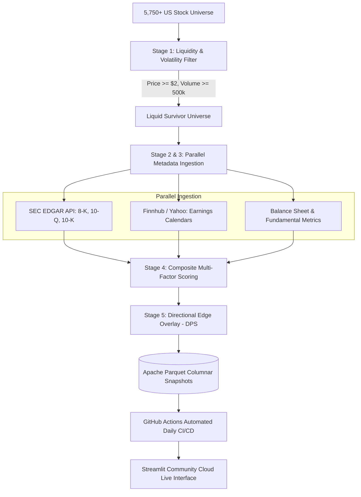

# Market Discovery Engine

[](https://market-discovery-engine.streamlit.app)
[](https://github.com/MathiasMesfin/market-discovery-engine/actions)
[](https://github.com/MathiasMesfin/market-discovery-engine/tree/main/tests)
[](https://www.python.org/)
[](LICENSE)

An institutional-grade quantitative research and market discovery terminal. The engine automatically scans **5,750+ US equities** each morning prior to market open, systematically filtering for liquidity, parsing SEC EDGAR regulatory filings, analyzing earnings calendars, and computing proprietary multi-factor catalyst scores.

**Live Terminal:** [market-discovery-engine.streamlit.app](https://market-discovery-engine.streamlit.app)  
**Author:** Mathias Mesfin

---

## Executive Overview

Active equity traders and quantitative research analysts face a common challenge: sorting through thousands of ticker symbols each morning to identify asymmetric risk-reward catalyst setups before market open. 

The **Market Discovery Engine** solves this by operationalizing a 5-stage automated screening and directional scoring pipeline:

1. **Pre-Market Headless Ingestion (06:00 AM EST):** An automated GitHub Actions cron daemon ingests market data, price action, and volume across NYSE and NASDAQ.
2. **SEC EDGAR & Fundamental Parsing:** Extracts recent material filings (Forms 8-K, 10-Q, 10-K), confirmed earnings announcement dates, balance sheet liquidity, and institutional short interest.
3. **Composite Scoring Framework:** Ranks candidates on a 0–100 scale using an institutional 60% Catalyst / 40% Momentum model.
4. **Directional Probability Overlay (DPS):** Computes Bayesian setup probabilities to identify *Spring-Loaded Value Winners*, *Contrarian Value Reversals*, and *Breakout Squeezes*.
5. **Sub-5ms Columnar Delivery:** Exports compressed Apache Parquet snapshots to eliminate API rate limits and deliver zero-latency instant rendering for production users.

---

## System Architecture



---

## Quantitative Methodology

### 1. Composite Final Score (0–100)
The engine integrates fundamental catalyst quality with technical momentum using an institutional 60/40 weighting framework:

$$\text{Final Score} = 0.60 \times \text{Catalyst Score} + 0.40 \times \text{Momentum Score}$$

* **Catalyst Score (60%):** Weighted function of days until confirmed earnings announcement, recent material SEC filings (8-K corporate actions, 10-Q/K disclosures), free cash flow stability, and balance sheet solvency.
* **Momentum Score (40%):** Evaluates Relative Volume expansion (RVOL), Average True Range (ATR) expansion, EMA 20/50 moving average trend alignment, and price momentum stability.

### 2. Directional Probability Score (DPS)
Beyond ranking, the engine assigns an expected probability of directional expansion using multi-factor setup archetypes:
* **Spring-Loaded Value Winner:** High short interest ($>10\%$) combined with confirmed near-term earnings catalysts ($<14$ days) and positive free cash flow.
* **Neutral Directional Setup:** Stable technical consolidation awaiting fundamental confirmation.
* **Exclusionary Safeguards:** Automatically penalizes and excludes micro-cap illiquidity, distressed financing indicators, and stale filing histories.

---

## Key Technical Features

* **Zero-Latency Pre-Market Mode:** Auto-loads pre-computed columnar Parquet snapshots (`daily_discovery_latest_full.parquet`), providing instant table rendering without making blocking runtime API requests.
* **Multi-Universe Granularity:** Seamlessly toggle between:
  * **Full Market:** All 5,750+ NYSE and NASDAQ equities.
  * **Discovery Pool:** Curated catalyst and growth stocks.
  * **Sample (50) & Test (20):** Rapid verification benchmarks.
* **Live On-Demand Lookup:** Individual ticker deep-dive engine allowing users to score and inspect any arbitrary US ticker in real-time.
* **Institutional Interface:** Dark terminal theme designed with Bloomberg and FactSet ergonomics (Inter typography, interactive Plotly candlestick charting, factor attribution dossiers).
* **Client-Side Privacy:** Built-in client CSV export (`st.download_button`) and private watchlist uploader ensuring user research data remains private.

---

## Automated CI/CD Infrastructure

The pre-market batch scan runs headlessly via GitHub Actions:
* **Workflow:** `.github/workflows/morning_scan.yml`
* **Trigger:** Weekdays at **06:00 AM EST** (`00 10 * * 1-5` UTC) via cron schedule.
* **Execution:**
  1. Spins up an Ubuntu runner with Python 3.9.
  2. Runs `scripts/morning_scan.py` across all universes in parallel using thread pools.
  3. Validates outputs and updates `data/history/daily_discovery_latest*.parquet`.
  4. Commits and pushes fresh datasets to GitHub with automated write permissions.
  5. Streamlit Cloud automatically detects the new commit and redeploys the fresh snapshot before market open.

---

## Verification & Testing

The codebase includes an automated test suite executed via `pytest`:

```bash
$ pytest tests/ -v
============================= test session starts ==============================
tests/test_api_fetch_telemetry.py .........                              [ 27%]
tests/test_batch_deep_scan.py .............                              [ 66%]
tests/test_directional_overlay.py ..........                             [ 96%]
tests/test_telemetry.py .                                                [100%]
======================== 33 passed in 0.75s =========================
```

Test coverage encompasses:
* API telemetry tracking, rate-limit resilience, and exponential backoff.
* Batch processing, multi-threading queue mechanics, and candidate state persistence.
* Directional probability scoring calibration and archetype classification.

---

## Local Development & Setup

### Prerequisites
* Python 3.9+
* macOS, Linux, or Windows WSL

### Installation

1. **Clone the repository:**
   ```bash
   git clone https://github.com/MathiasMesfin/market-discovery-engine.git
   cd market-discovery-engine
   ```

2. **Create and activate a virtual environment:**
   ```bash
   python3 -m venv .venv
   source .venv/bin/activate
   ```

3. **Install dependencies:**
   ```bash
   pip install -r requirements.txt
   ```

4. **Launch the local Streamlit application:**
   ```bash
   streamlit run app.py
   ```
   Open your browser at `http://localhost:8501`.

5. **Execute a headless morning scan manually:**
   ```bash
   # Quick benchmark scan
   python scripts/morning_scan.py --universe test

   # Full market scan
   python scripts/morning_scan.py --universe full
   ```

---

## License

This project is licensed under the MIT License — see the [LICENSE](LICENSE) file for details.
