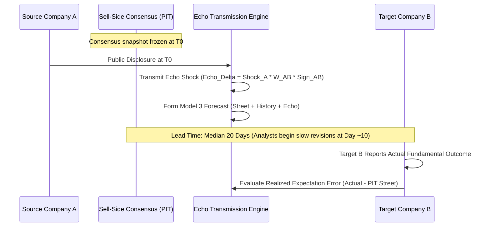

# PROJECT ECHO — PHASE 4: METHODOLOGY REPORT
## Street Expectation Error Prediction

---

### 1. Scientific Objective

Phase 4 tests whether Echo's validated cross-company fundamental transmission signal contains incremental predictive information regarding **errors in sell-side Street expectations** for Target Company $B$ before $B$ reports its own operating results:

$$\text{Operational Shock at } A \implies \Delta \text{Future Target Fundamental}_B \implies \text{Predictable Sell-Side Expectation Error}_B$$

### 2. Information Timing Architecture

### 3. Model Formulations

1. **Model 1 (Street Only)**:
   $$\widehat{Y}_{\text{Model 1}} = \text{PIT\_Street\_Expectation}$$

2. **Model 2 (Street + Target History)**:
   $$\widehat{Y}_{\text{Model 2}} = \text{PIT\_Street\_Expectation} + 0.35 \times (\text{Baseline\_Forecast} - \text{PIT\_Street\_Expectation})$$

3. **Model 3 (Street + Target History + Echo)**:
   $$\widehat{Y}_{\text{Model 3}} = \widehat{Y}_{\text{Model 2}} + \text{Echo\_Delta}_{\text{Net}}$$
