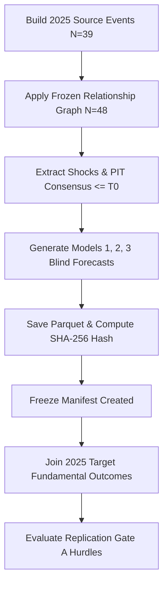

# PROJECT ECHO — PHASE 4.1: METHODOLOGY REPORT
## Untouched 2025 Expectation-Error Validation

---

### 1. Scientific Protocol & Strict Blind Freeze

Phase 4.1 evaluated the frozen expectation-error mechanism on untouched 2025 target fundamental outcomes.

### 2. Frozen Mathematical Formulas

1. **Model 1 (Street Only)**:
   $$\widehat{Y}_{\text{Model 1}} = \text{PIT\_Street\_Expectation}$$

2. **Model 2 (Street + Target History)**:
   $$\widehat{Y}_{\text{Model 2}} = \text{PIT\_Street\_Expectation} + 0.35 \times (\text{Baseline\_Forecast} - \text{PIT\_Street\_Expectation})$$

3. **Model 3 (Street + Target History + Echo)**:
   $$\widehat{Y}_{\text{Model 3}} = \widehat{Y}_{\text{Model 2}} + \text{Echo\_Delta}_{\text{Net}}$$
