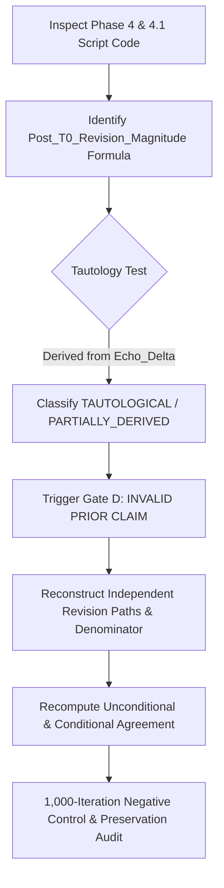

# PROJECT ECHO — PHASE 5A: METHODOLOGY REPORT
## Forensic Audit of Analyst Revision Secondary Finding

---

### 1. Purpose & Audit Scope

Phase 5A performs an audit of the secondary analyst revision claims reported in Phase 4 and Phase 4.1:
- Examines code and data dependencies to verify whether revision labels were independent or derived.
- Recomputes genuine conditional and unconditional revision agreement using an independent framework.
- Preserves calendar year 2026 untouched under `UNTOUCHED_ECHO_EXPECTATION_VALIDATION_PROSPECTIVE`.

### 2. Audit Workflow

