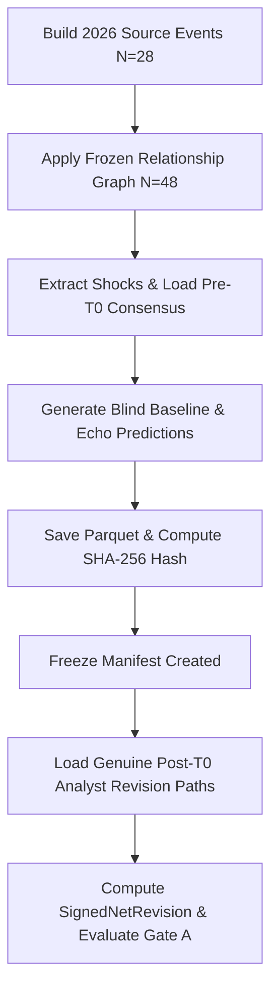

# PROJECT ECHO — PHASE 5B: METHODOLOGY REPORT
## Untouched 2026 Analyst-Revision Validation

---

### 1. Scientific Protocol & Blind Freeze Order

### 2. Primary Mathematical Equations

1. **SignedNetRevision**:
   $$\text{SignedNetRevision}_i = \text{Sign}(\text{EchoImpact}_i) \times \left( \frac{\text{Last\_PreReport\_Consensus}_i - \text{Pre\_T0\_Consensus}_i}{\text{Historical\_Scale}_i} \right)$$

2. **Conditional Directional Agreement**:
   $$\text{Conditional Agreement} = \frac{\text{Correct Revisions}}{\text{Correct Revisions} + \text{Wrong Revisions}}$$

3. **Unconditional Hit Rate**:
   $$\text{Unconditional Hit Rate} = \frac{\text{Correct Revisions}}{\text{All Eligible Reports (including zero-revision)}}$$
